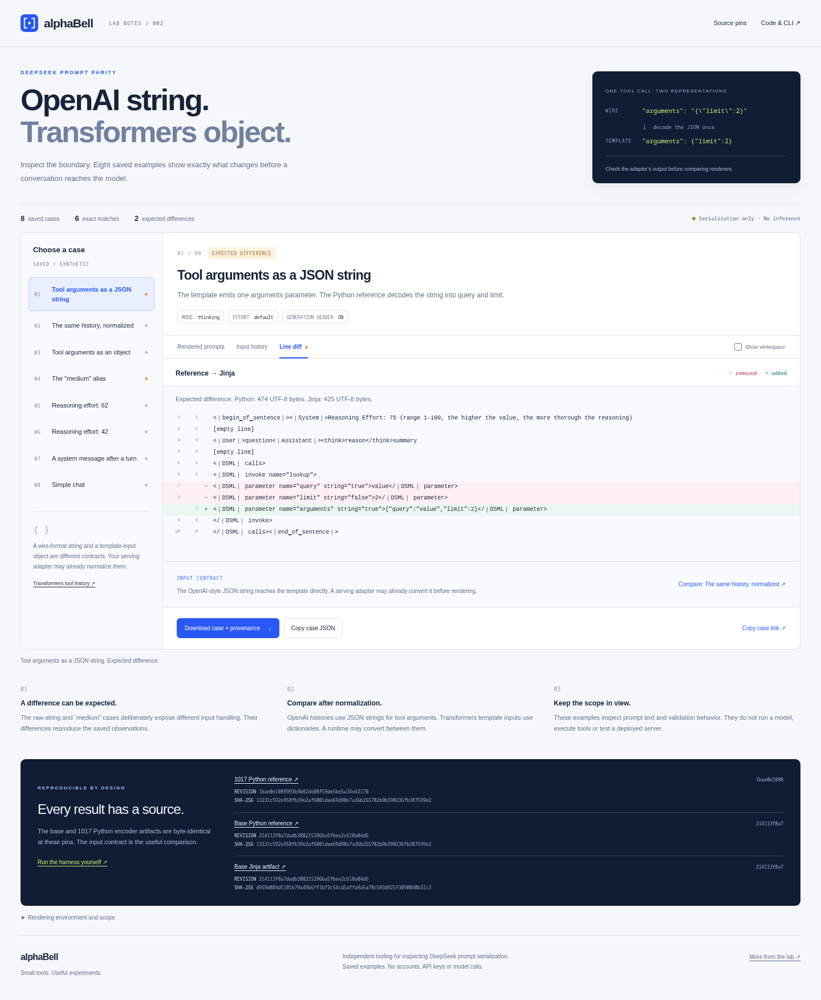

# DeepSeek Prompt Parity

**[Explore the saved cases](https://huggingface.co/spaces/alphabell/DeepSeek-Prompt-Parity)** · [Source and CLI](https://github.com/alphabell-research/deepseek-prompt-parity)



The browser explorer shows eight synthetic, source-checked examples. Choose raw or normalized tool history, inspect both rendered prompts, reveal whitespace and download the exact case with source pins. It runs saved cases locally and makes no model call. It does not render arbitrary user inputs.

The browser's six exact matches and two expected differences describe these saved examples. Each export includes the input, outputs or errors, expected result and source hashes. The base and 1017 Python encoders are byte-identical at the pinned revisions.

## Browser and fixture checks

Serve this directory with a static HTTP server and open `index.html`. The UI requires no build step or runtime API key. To exercise the browser checks:

```bash
python -m pip install -r requirements-browser.txt
python -m playwright install chromium
python verify.py
```

`verify.py --base-url URL` checks a hosted static copy. Twelve browser groups cover exact outputs and UTF-8 sizes, expected errors, whitespace-safe copies, provenance downloads, keyboard and touch controls, source visibility, line endings, safe literal rendering, load failures, mobile layout and network isolation.

`generate_fixtures.py --offline --check` checks the committed snapshots against the verified source cache without changing them. The CLI and generation tests cover strict normalization, integrity failures and fixture drift. Reference rendering checks formatting and validation behavior, rather than model or serving quality.

## CLI harness

Reproduce the boundary between OpenAI tool history and DeepSeek's chat template. Compare raw JSON-string arguments with parsed objects, inspect the exact prompt diff, and run the pinned upstream encoder tests.

The previous DeepSeek-V4.1-Flash Python encoder and the 1017 encoder are **byte-identical** at the revisions below. The useful question is which input contract reaches the template.

## Run

Python 3.11 or later:

```bash
python -m venv .venv
source .venv/bin/activate
python -m pip install -r requirements-dev.txt
python parity.py --show-diff --run-upstream-tests --report reports/parity.json
```

The first run downloads three small checksum-pinned source files. `--run-upstream-tests` also downloads the official test module and its text/JSON fixtures. Downloaded files stay in `.cache/`, outside version control. The repository vendors no upstream implementation.

Repeat entirely from the verified cache:

```bash
python parity.py --offline --run-upstream-tests
python -m pytest -q tests
```

Source retrieval happens before execution. Python socket operations are disabled while the references render prompts and while the upstream tests execute. The harness uses synthetic histories and requires no model weights, tokenizer or GPU.

Exit status is `0` when every expected observation is reproduced, `1` for an unexpected comparison or upstream test result, and `2` for a download, integrity or setup failure. An expected difference is a successful reproduction.

## The integration trap

This is an OpenAI-style history value:

```json
{"name":"lookup","arguments":"{\"query\":\"value\",\"limit\":2}"}
```

The published base Jinja artifact sees a string and renders one DSML parameter named `arguments`. The Python reference decodes that JSON and emits two parameters: `query` as a string and `limit` as a number.

The same history with parsed arguments matches exactly in this probe:

```json
{"name":"lookup","arguments":{"query":"value","limit":2}}
```

[Transformers expects tool-call arguments as dictionaries](https://huggingface.co/docs/transformers/chat_extras), while OpenAI wire histories use JSON strings. A serving adapter may already perform this conversion. Compare the history after that adapter's normalization step. This is an input-contract check, not evidence of a serving-runtime bug.

`normalize_tool_arguments()` provides the explicit conversion used in the probe. It deep-copies history, decodes each function argument string once, requires an object, and preserves unrelated fields and valid large integers. It rejects malformed JSON, duplicate keys, double-encoded strings and non-object values. Both string inputs and already-parsed objects reject non-finite numbers, including overflowing float literals, cycles and non-JSON values. This helper checks the argument-object boundary; it does not validate a complete request or a tool's JSON Schema.

## Expected observations

| Probe | Result |
| --- | --- |
| Simple chat | Exact prompt match |
| Numeric reasoning effort 42 | Exact prompt match |
| Numeric reasoning effort 62 | Exact prompt match |
| Mid-conversation system message | Exact prompt match |
| Tool arguments supplied as an object | Exact prompt match |
| Tool arguments supplied as a raw JSON string | Different DSML parameters |
| The same JSON-string history after normalization | Exact prompt match |
| `reasoning_effort="medium"` | Jinja maps to 62; Python reference rejects the alias |

The report includes both rendered prompts, errors, unified diffs, source URLs and SHA-256 values. The optional upstream run executes the complete pinned encoder suite, including its five golden prompt pairs. At these pins, the suite expands to 55 tests.

These checks measure serialization and validation behavior. They do not run inference or measure model quality, tool success or a deployed server's behavior.

## Source pins and rendering environment

| Artifact | Revision |
| --- | --- |
| [1017 Python reference and tests](https://huggingface.co/deepseek-ai/DeepSeek-V4.1-Flash-1017/tree/1bae0e1088993b9b82de08f59de5be5a34e42170/encoding) | `1bae0e1088993b9b82de08f59de5be5a34e42170` |
| [Base Python reference](https://huggingface.co/deepseek-ai/DeepSeek-V4.1-Flash/blob/314113f8a7dadb388215396ba5fbee2c610a04d6/encoding/encoding.py) | `314113f8a7dadb388215396ba5fbee2c610a04d6` |
| [Published base Jinja artifact](https://huggingface.co/deepseek-ai/DeepSeek-V4.1-Flash/blob/314113f8a7dadb388215396ba5fbee2c610a04d6/chat_template.jinja) | `314113f8a7dadb388215396ba5fbee2c610a04d6` |

Jinja2 3.1.6 runs in an immutable sandbox with `trim_blocks` and `lstrip_blocks`, a Transformers-style JSON filter, and `add_generation_prompt=True`. The harness does not import Transformers or a serving adapter. It compares exact prompt strings, not token IDs or pixel processing.

Both pinned model cards direct users to the Python reference and [deepseek-recipe](https://github.com/deepseek-ai/deepseek-recipe) for protocol handling. The presence of the base Jinja file is separate from that recommendation.

`sources.json` contains the complete allowlist and integrity hashes. All fetched upstream artifacts remain under their original [MIT license](https://huggingface.co/deepseek-ai/DeepSeek-V4.1-Flash-1017/blob/1bae0e1088993b9b82de08f59de5be5a34e42170/LICENSE). This harness is MIT licensed.

By [alphaBell](https://huggingface.co/alphabell).
